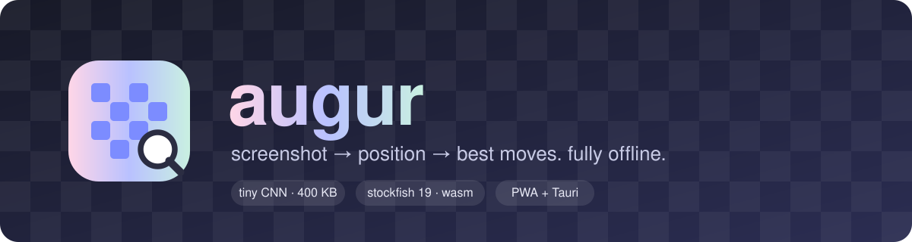
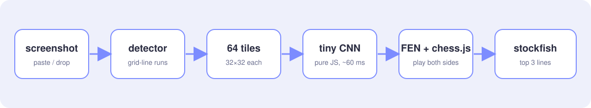
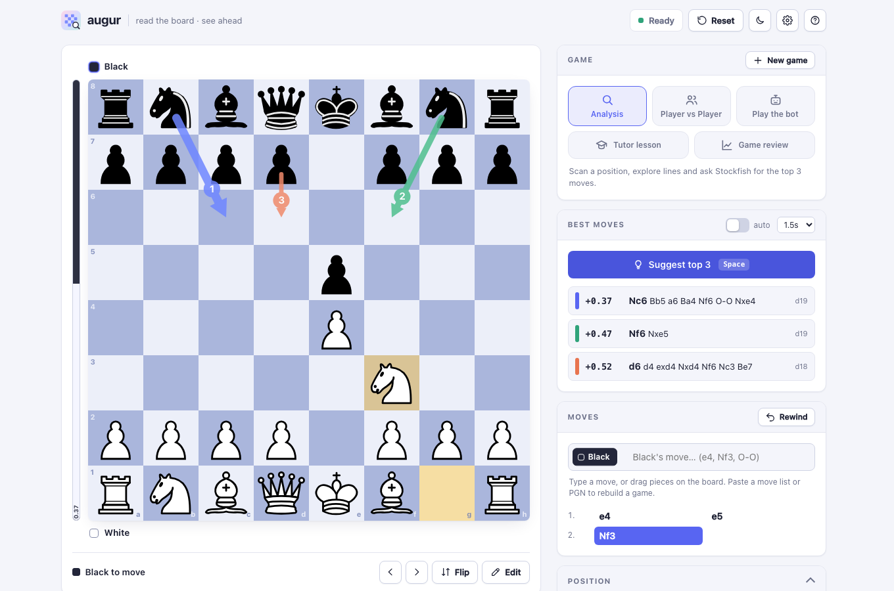
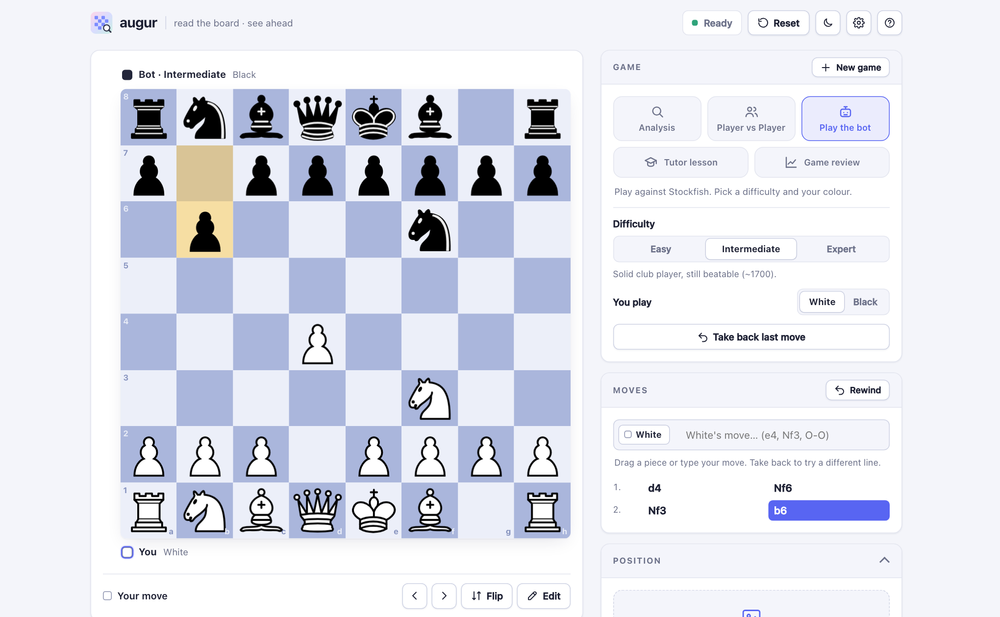
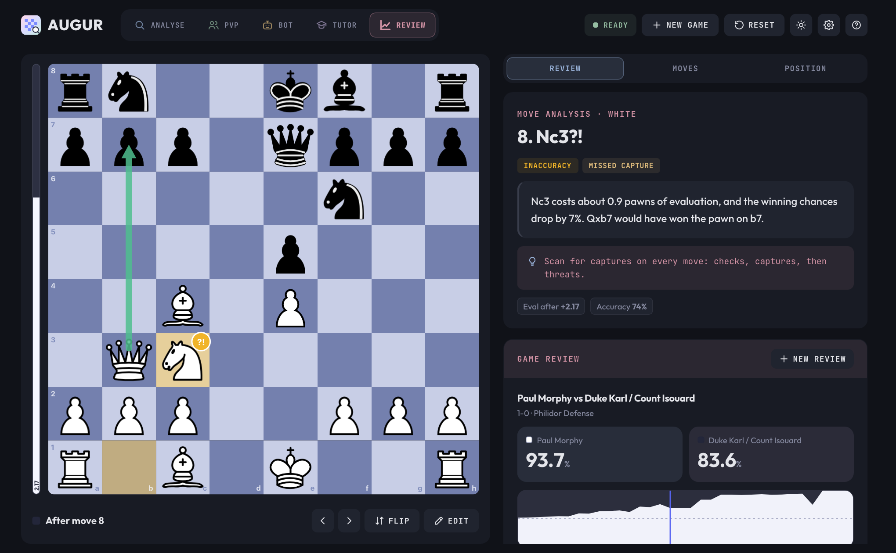
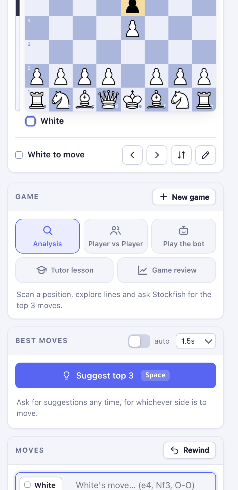
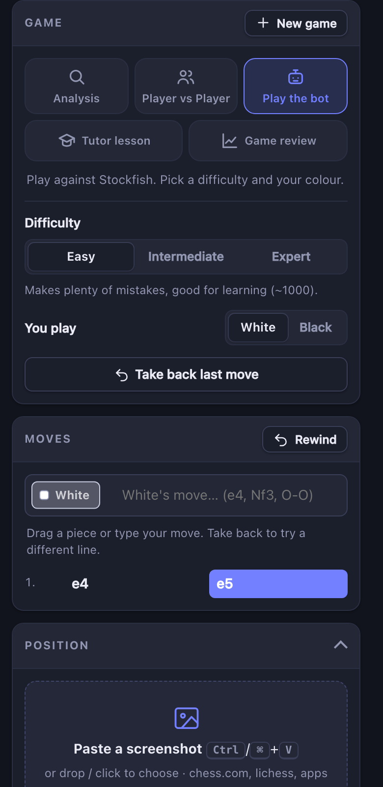
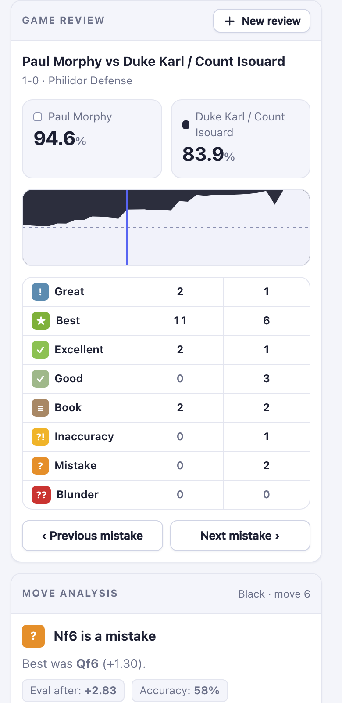

<p align="center"></p>

# augur

paste a screenshot of a chessboard → the position is read locally in under a second → keep playing it move by move for either side → ask stockfish for the top 3 moves whenever you want.

no server, works offline (the optional AI tutor is the only thing that talks to the network, and only if you add your own key). web app (installable PWA) + native desktop app (macOS / Ubuntu / any Linux) from the same code.

```
screenshot ──► board detector ──► 64 tiles ──► tiny CNN (≈400 KB) ──► FEN ──► chess.js ◄──► you
               (grid-line runs)                 pure JS, no deps                  │
                                                                                  ▼
                                                              stockfish 19 lite (wasm, 1.8 MB, MultiPV 3)
```

<p align="center"></p>

<p align="center"></p>

<table>
  <tr>
    <td width="50%"></td>
    <td width="50%"></td>
  </tr>
  <tr>
    <td align="center"><sub>Play the bot (Easy / Intermediate / Expert)</sub></td>
    <td align="center"><sub>Game review from a pasted PGN</sub></td>
  </tr>
</table>

<table>
  <tr>
    <td width="33%"></td>
    <td width="33%"></td>
    <td width="33%"></td>
  </tr>
  <tr>
    <td align="center"><sub>Phone, light</sub></td>
    <td align="center"><sub>Phone, dark</sub></td>
    <td align="center"><sub>Phone, review</sub></td>
  </tr>
</table>

## layout

a slim **mode rail** on the left switches between the five modes; the side panel has a **sub-navbar** (Engine / Game / Lesson / Review, Moves, Position) so only one group of controls shows at a time. every mode has a horizontal **move timeline** whose chips are colour-coded by grade, and the tutor and review share one focused **lesson card**: the move, its grade and motifs, the explanation, and a tip box with the better move and the habit to build.

## modes

| mode | what you get |
|---|---|
| **Analysis** | scan a screenshot, explore lines, top-3 Stockfish suggestions with eval bar. |
| **Player vs Player** | two humans, one board. optional **hints** (off by default): Stockfish shows a single suggested move on request. optional **clocks**: untimed, 3, 5 or 10 minutes (the clock starts after the first move, flag fall loses on time). |
| **Play the bot** | Stockfish at three levels, *Easy* (~1000), *Intermediate* (~1700, Elo-limited), *Expert* (full strength). pick your colour, take moves back. replies come back in about a quarter of a second, and you can play it on a 3, 5 or 10 minute clock too. the bot can't hang: if Stockfish fails to load or answer in time (some phones can't allocate the WASM heap), a small built-in alpha-beta engine (`src/minibot.js`) moves instead. |
| **Tutor lesson** | play the bot while a tutor explains every move (yours and the bot's) in plain English. each move is graded (best / good / inaccuracy / mistake / blunder…) by Stockfish; the wording comes from an LLM using **your own API key** (Anthropic, OpenAI, Gemini, OpenRouter or any OpenAI-compatible/local endpoint). without a key you still get the engine's verdict and the better move. |
| **Coach layer** | every graded move (tutor and review) also gets **tactical motifs** found by board geometry on chess.js: hanging pieces, missed captures, forks, pins, skewers, discovered attacks and checks, king-safety changes (castling rights, pawn shield, pressure around the king), and missed or allowed checkmates. they show as chips, the opponent's punishing reply is drawn as a red arrow, and they feed both explanation layers: a **deterministic template explainer** (offline, instant, never contradicts the engine) and, if you add a key, the AI tutor, which receives them as verified facts. |
| **Export & share** | the *Export* button on the Moves panel gives a standard **PGN** (seven-tag roster, players, result, opening, time control, `[FEN]` for custom starts), optionally **annotated** with move-grade NAGs and Lichess-style `[%eval]` comments after a review or tutor lesson. copy it, download a `.pgn`, or use the device share sheet. also: copy the **FEN**, copy an upload-free **share link** (the moves live in the URL; opening it loads the game), or **open in Lichess**. |
| **Game review** | paste a PGN exported from chess.com, lichess or any app (or open a `.pgn`, or review the game you just played). you get accuracy for both sides, an eval graph, a classification table (brilliant → blunder), the opening name, "previous / next mistake" navigation, a best-move arrow plus badge on the board, and an optional "explain this move" via the AI tutor. it works the way fast review sites do: a shallow pass (depth 9) streams in move by move and gives the full review in well under a second, then a deeper pass (depth 14 Standard, 18 Deep) refines it in the background while you read. each worker takes a contiguous run of positions so its hash table carries over, the refining pass walks backwards (the trick Lichess's fishnet uses), searches exit early once the best move is stable, known opening moves get a quick look only, and the workers shut down after use. you also get accuracy by phase (opening / middlegame / endgame), a "How was this produced?" panel, and plain-English template explanations built from the engine's numbers when no AI key is set. |

settings (gear icon):

- **General**: theme (system / light / dark), how many moves Stockfish suggests (best only, top 2 or top 3), auto-analyse, think time.
- **Board**: coordinates, legal-move dots, evaluation bar, piece animation, always promote to queen.
- **AI tutor**: explain both sides or only your moves, explanation level (beginner / club / advanced), provider, API key and model. the key lives in this browser's `localStorage` and is sent only to the provider you pick.
- **Restore defaults** resets the options above; the header **Reset** button resets the whole app (board, history, scan and settings).

## what it does

| | |
|---|---|
| **scan** | `Ctrl/⌘+V` a screenshot (chess.com, lichess, apps, video frames), drop a file, or click *paste*. full-window screenshots are fine, it finds the board itself. |
| **or: AI chat** | no screenshot model wanted? *"or read it with any AI chat"* gives a copy-paste prompt for Gemini/ChatGPT/Claude; paste its reply back (JSON, FEN, or the whole message) and it loads. pasting a FEN anywhere also works. |
| **fix** | low-confidence squares get an amber ring. drag the crop box on the preview to re-read, or hit `E` to edit (piece palette, right-click to erase, drag to move). |
| **setup** | *seen from* (auto-guessed), *to move* (defaults to the side at the bottom), castling rights (auto-sanitised from king/rook squares), FEN in/out. |
| **play** | one box, moves alternate: it shows whose turn it is (white/black tag), you type white's move, then black's, etc., or drag/click on the board. `e4`, `Nf3`, `exd5`, `O-O`, `e7e8q`, `e2e4` all work. `←/→` step back/forward; playing from an earlier move branches. |
| **rebuild old games** | paste a whole move list (`1. e4 e5 2. Nf3 …`) or a full PGN (headers, comments, variations are stripped; `[FEN]` honoured), it replays all moves and stops at the first illegal one. a bare list without move numbers continues from the current position. |
| **suggest** | `Space` (also inside the empty move box) → top 3 lines with eval, depth, PV, numbered arrows. type `1`/`2`/`3` + Enter in the move box (or click the line) to play it. *auto* re-analyses after every move. think time 0.5–3 s. multi-threaded engine when the page is cross-origin isolated (native app, dev server), single-thread otherwise. |

## run it

```bash
cd app
npm install
npm run dev          # web: http://localhost:5173
npm run build        # static site in app/dist, host anywhere (github pages, netlify, …)
```

the built site is a PWA: open it in chrome/edge → *install app*. after first load everything (engine + model) is cached and it works offline.

### download the desktop app

native builds for **macOS on Apple Silicon** (`.dmg`) and **Ubuntu / Linux** (`.deb` and `.AppImage`) are attached to each [GitHub release](https://github.com/1mystic/Augur/releases). they run fully offline with the same features. the macOS build is not notarised yet: on first launch right-click the app and choose *Open* (or run `xattr -dr com.apple.quarantine /Applications/Augur.app`).

### native desktop (Tauri, small installers, system webview)

```bash
# one-time: rust (https://rustup.rs) and, on ubuntu/debian:
sudo apt install libwebkit2gtk-4.1-dev librsvg2-dev libayatana-appindicator3-dev libxdo-dev
cd app
npm run app:dev      # dev window
npm run app:build    # → src-tauri/target/release/bundle/{deb,appimage,dmg,macos}
```

macOS builds need a mac (or use CI). `.github/workflows/desktop.yml` builds `.dmg` (Apple Silicon + Intel), `.deb` and `.AppImage` on every `v*` tag and attaches them to a draft release.

native adds one thing over the web build: clipboard images are read through the OS (`arboard`), because WebKit webviews don't always hand pasted images to JS.

## accuracy / speed (this build)

| test set | squares | perfect boards | board found | orientation | median time |
|---|---|---|---|---|---|
| `firi` piece set, **never seen in training** | 100% | 16/16 | 16/16 | 16/16 | ~0.65 s |
| small boards (240–320 px) in 1080p screenshots | 100% | 12/12 | 12/12 | 12/12 | ~0.6 s |
| tile-level held-out val (hard augmentations) | 95.5% | n/a | n/a | n/a | n/a |

full-screenshot tests are synthetic (UI bars, highlights, coords, jpeg). real chess.com piece styles aren't open-licence so they're not in training, if a set misreads, amber rings show which squares to fix, and the AI-chat route is always there.

### deploy on vercel (free tier)

the repo ships `vercel.json` (repo root) and `app/vercel.json` (if you set *Root Directory* to `app`). they:

- build with `npm ci` + `vite build` and serve `app/dist`, a ~5 MB static site, no functions, so it sits comfortably inside the free plan;
- add `Cross-Origin-Opener/Embedder-Policy` headers → cross-origin isolation → **multi-threaded Stockfish**;
- cache `/assets/*` as immutable (hashed file names) and the engine / model / pieces for a day with stale-while-revalidate, so repeat visits cost almost no bandwidth; `sw.js` and `index.html` always revalidate.

`.vercelignore` keeps training code and tests out of CLI uploads.

## the vision model

trained from scratch, see `train/`.

- **data**: 160k synthetic 32×32 tiles rendered from 33 open lichess piece sets on ~20 real board themes + random pastel/dark themes. each tile is cut from a 3×3 neighbourhood so crops bleed like real ones, with last-move highlights, check glow, coordinates, move dots, capture rings, arrows, wood/noise textures, blur, JPEG artifacts, brightness jitter, crop jitter.
- **model**: 3× (conv3×3 → relu → maxpool) + dense 96 + dense 13. ~110k params, float32 blob ≈ 400 KB. forward pass is ~60 lines of plain JS (`src/vision/classify.js`).
- **board detection** (`src/vision/detect.js`): every internal grid line of a checkerboard is one unbroken colour edge exactly the board's height. find columns/rows with long edge runs, group by run span, keep the group whose spacing = span/8. no ML needed, ~50 ms.

retrain:

```bash
cd train
pip install jax optax cairosvg pillow numpy chess
python gen.py 80000 11 data/tr1.npz            # tiles (any number of shards)
python gen.py 6000 99 data/val.npz alpha,staunty
python train.py data/tr1.npz data/val.npz 8 data/augur
cp data/augur.bin data/augur.json ../app/public/model/
python make_tests.py ../tests/shots 24 alpha,staunty,leipzig   # full screenshots + truth.json
```

## layout

```
app/
  index.html, src/main.js     UI + state (history, branching, setup)
  src/board.js                board: drag/click, legal dots, arrows, edit mode, promotion
  src/engine.js               stockfish worker wrapper (MultiPV, UCI options, stop/restart queue)
  src/coach.js                eval maths, move classification, accuracy, opening names
  src/llm.js                  bring-your-own-key LLM client (Anthropic / OpenAI-compatible)
  src/review.js               HTML builders for the review + tutor panels
  src/vision/                 detector + CNN
  public/engine/              stockfish-19-lite-single.{js,wasm}
  public/model/               augur.{bin,json}
  src-tauri/                  native shell (rust)
train/                        data generator, trainer, test-screenshot maker
tests/                        e2e accuracy/timing script
```

## licences

GPL-3.0-or-later (because it ships Stockfish, GPLv3). piece images: cburnett, CC BY-SA 3.0. training piece sets from lichess (each set has its own licence, they're used only as training data, not shipped).
